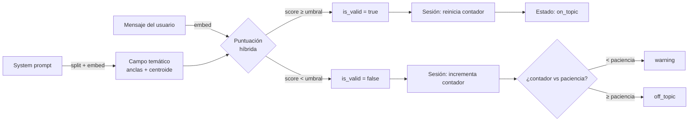

# LLMKeeper

**Guardián local de deriva temática para conversaciones con LLMs.**

LLMKeeper comprueba si los mensajes de una conversación se mantienen dentro del tema definido por un *system prompt*. Usa embeddings semánticos que se calculan en local (CPU), así que ningún texto sale de tu máquina.

> Ejemplo: si tu asistente es un experto en cocina y un usuario pregunta por la capital de Francia, LLMKeeper marca ese mensaje como fuera de tema. Si son varios mensajes fuera de tema seguidos, la sesión pasa a `warning` y después a `off_topic`.

---

## Índice

- [Qué problema resuelve](#qué-problema-resuelve)
- [Características](#características)
- [Instalación](#instalación)
- [Inicio rápido](#inicio-rápido)
- [Flujo general](#flujo-general)
- [Endpoints](#endpoints)
- [Configuración](#configuración)
- [Documentación extra](#documentación-extra)
- [Tests](#tests)
- [Estructura del proyecto](#estructura-del-proyecto)
- [Limitaciones conocidas](#limitaciones-conocidas)
- [Licencia](#licencia)

---

## Qué problema resuelve

Un asistente basado en LLM debe responder dentro de un ámbito concreto (atención al cliente de una tienda, un tutor de matemáticas, un asistente de cocina…). Los usuarios, a menudo sin mala intención, se salen de ese ámbito, y el modelo les sigue la corriente.

LLMKeeper da una **señal numérica y un estado** por mensaje:

1. Convierte el *system prompt* en un **campo temático**: un conjunto de anclas semánticas (una por frase o viñeta) y su centroide.
2. Puntúa cada mensaje contra ese campo.
3. Lleva el **estado de la conversación** (en tema, advertencia, fuera de tema) teniendo en cuenta la paciencia configurada, para no alarmar por una desviación puntual.

La decisión de qué hacer con la señal (bloquear, redirigir, avisar al usuario) es tuya; LLMKeeper solo mide y resume.

## Características

- **Embeddings locales.** `sentence-transformers` con `paraphrase-multilingual-MiniLM-L12-v2` (384 dimensiones, multilingüe, incluido español). Sin llamadas a APIs externas.
- **Construcción automática del campo temático.** Divide el *system prompt* por viñetas o por frases, descarta fragmentos demasiado cortos o repetidos y limita el número de anclas.
- **Temas adicionales.** Puedes añadir temas que no estén en el *system prompt* con `extra_topics`.
- **Puntuación híbrida.** Combina la similitud con las anclas más cercanas y la similitud con el centroide (ver [docs/puntuacion.md](docs/puntuacion.md)).
- **Niveles de estrictitud.** Cinco presets (`muy_estricto` … `muy_permisivo`) o un umbral personalizado en [0, 1].
- **Sesiones de conversación.** Contador de mensajes consecutivos fuera de tema, media móvil y paciencia configurable.
- **API REST** con FastAPI y documentación interactiva en `/docs`.
- **Arquitectura hexagonal.** Dominio, puertos, casos de uso y adaptadores separados (ver [docs/arquitectura.md](docs/arquitectura.md)).

## Instalación

Requisitos: **Python 3.10+**.

```bash
git clone <url-del-repo> llmkeeper
cd llmkeeper

python -m venv .venv
source .venv/bin/activate          # Windows: .venv\Scripts\activate

pip install -e ".[dev]"
```

Opcional, para evitar descargar las dependencias CUDA de PyTorch:

```bash
pip install torch --index-url https://download.pytorch.org/whl/cpu
```

La primera ejecución que cree el servicio descargará el modelo de embeddings desde Hugging Face (varios cientos de MB) y lo cacheará localmente.

## Inicio rápido

### 1. Arrancar el servidor

```bash
python main.py
```

El servidor escucha en `http://127.0.0.1:8000`. La documentación interactiva está en `http://127.0.0.1:8000/docs`.

### 2. Crear un campo temático

```bash
curl -X POST http://127.0.0.1:8000/api/v1/fields \
  -H "Content-Type: application/json" \
  -d '{
    "system_prompt": "Eres un experto en cocina. Ayudas con recetas, ingredientes y técnicas culinarias.",
    "strictness_preset": "moderado"
  }'
```

Respuesta (valores ilustrativos):

```json
{
  "field_id": "e2d8f5b6-7c1a-4f0e-9d3b-2a6c8e1f4b90",
  "system_prompt": "Eres un experto en cocina. Ayudas con recetas, ingredientes y técnicas culinarias.",
  "num_anchors": 2,
  "dispersion": 0.31,
  "threshold": 0.22,
  "preset": "moderado",
  "alpha": 0.7,
  "top_k": 3
}
```

Guarda el `field_id`: lo necesitan el resto de llamadas.

### 3. Validar un mensaje suelto (sin estado)

```bash
curl -X POST http://127.0.0.1:8000/api/v1/fields/<field_id>/validate \
  -H "Content-Type: application/json" \
  -d '{"text": "¿Qué ingredientes necesito para una paella?"}'
```

```json
{
  "is_valid": true,
  "score": 0.64,
  "threshold": 0.22,
  "nearest_anchor_text": "Ayudas con recetas, ingredientes y técnicas culinarias."
}
```

### 4. Seguir una conversación

```bash
# Crear la sesión
curl -X POST http://127.0.0.1:8000/api/v1/fields/<field_id>/sessions \
  -H "Content-Type: application/json" \
  -d '{"patience": 3, "rolling_window": 5}'

# Enviar mensajes de la conversación
curl -X POST http://127.0.0.1:8000/api/v1/sessions/<session_id>/messages \
  -H "Content-Type: application/json" \
  -d '{"text": "¿Cuál es la capital de Francia?"}'
```

La respuesta incluye `status` (`on_topic`, `warning` u `off_topic`), `consecutive_off` y `rolling_average`. Ver [docs/flujos.md](docs/flujos.md#flujo-de-sesión-y-estados) para cómo evoluciona el estado.

## Flujo general



El detalle de cada flujo (creación, validación, sesiones, cambio de estrictud, errores) está en [docs/flujos.md](docs/flujos.md).

## Endpoints

Todos los endpoints cuelgan de `/api/v1`.

| Método | Ruta | Descripción | Código de éxito |
|--------|------|-------------|-----------------|
| `POST` | `/fields` | Crea un campo temático a partir de un *system prompt* | `200` |
| `GET` | `/fields/{field_id}` | Devuelve los metadatos de un campo | `200` |
| `PATCH` | `/fields/{field_id}/strictness` | Cambia el nivel o umbral de estrictud | `200` |
| `POST` | `/fields/{field_id}/validate` | Puntúa un mensaje sin guardar estado | `200` |
| `POST` | `/fields/{field_id}/sessions` | Crea una sesión de conversación | `200` |
| `POST` | `/sessions/{session_id}/messages` | Añade un mensaje a la sesión y actualiza su estado | `200` |
| `GET` | `/sessions/{session_id}` | Devuelve el estado actual de una sesión | `200` |

Referencia completa con cuerpos, respuestas y errores: [docs/api.md](docs/api.md).

## Configuración

La configuración se lee de variables de entorno o de un fichero `.env` en la raíz del proyecto (gestionado por `pydantic-settings`).

```env
EMBEDDING_MODEL_NAME=paraphrase-multilingual-MiniLM-L12-v2
```

| Variable | Valor por defecto | Estado |
|----------|-------------------|--------|
| `EMBEDDING_MODEL_NAME` | `paraphrase-multilingual-MiniLM-L12-v2` | **Activa.** Modelo de `sentence-transformers` que se carga al arrancar. |
| `DB_PATH` | `llmkeeper.db` | **No usada.** Reservada para la persistencia SQLite (pendiente). |
| `DEFAULT_PATIENCE` | `3` | **No usada.** La paciencia por defecto está fijada en el código a `3`. |
| `DEFAULT_ROLLING_WINDOW` | `5` | **No usada.** Ventana por defecto fijada a `5` en el código. |
| `DEFAULT_ALPHA` | `0.7` | **No usada.** `alpha` está fijado a `0.7` en el código. |
| `DEFAULT_TOP_K` | `3` | **No usada.** `top_k` está fijado a `3` en el código. |

> Las variables marcadas como "no usada" existen en `infrastructure/config.py` pero ningún componente las lee todavía. Cambiarlas no tiene efecto. Ver [docs/desarrollo.md](docs/desarrollo.md#limitaciones-conocidas).

### Niveles de estrictud

| Preset | Umbral | Cuándo usarlo |
|--------|--------|----------------|
| `muy_estricto` | 0.32 | Solo acepta mensajes muy cercanos al tema. Más falsos positivos. |
| `estricto` | 0.27 | Tema acotado; tolera poco. |
| `moderado` | 0.22 | **Valor por defecto.** Equilibrio general. |
| `permisivo` | 0.17 | Tolera preguntas tangenciales. |
| `muy_permisivo` | 0.12 | Solo bloquea desvíos claros. Más falsos negativos. |

También puedes indicar un `strictness_value` numérico en `[0, 1]`. Los presets están en el rango 0.12–0.32; valores fuera de él son posibles pero requieren calibración propia. Detalles en [docs/puntuacion.md](docs/puntuacion.md#niveles-de-estrictud).

## Documentación extra

| Documento | Contenido |
|-----------|-----------|
| [docs/arquitectura.md](docs/arquitectura.md) | Capas hexagonales, dependencias, contenedor y ciclo de vida de la app |
| [docs/flujos.md](docs/flujos.md) | Flujos paso a paso: creación de campo, validación, sesiones, estrictud, errores |
| [docs/puntuacion.md](docs/puntuacion.md) | Fórmula de puntuación, chunking, centroide, dispersión y niveles |
| [docs/api.md](docs/api.md) | Referencia de la API REST |
| [docs/desarrollo.md](docs/desarrollo.md) | Tests, cómo extender el proyecto y limitaciones conocidas |
| [scripts/README.md](scripts/README.md) | Experimento de detección de *prompt injections* por dirección vectorial (separado del servicio) |

## Experimento: detección de prompt injections

Además del servicio, el repositorio incluye un experimento independiente en `scripts/injection_direction.py`. Codifica prompts con el mismo modelo de embeddings, guarda las direcciones de las inyecciones conocidas en ChromaDB y usa un MILP con PuLP para elegir el umbral de distancia que maximiza `TP − FP`, con al menos un 95 % de los prompts seguros sin marcar.

No forma parte del servicio y tiene dependencias propias (`datasets`, `pulp`, `chromadb`). Detalles, configuración y limitaciones en [scripts/README.md](scripts/README.md).

> **Pendiente:** las métricas de `scripts/README.md` y las de la última ejecución registrada en `scripts/injection_direction.log` no coinciden. Hasta verificarlas no se citan aquí cifras de resultados.

## Tests

```bash
# Tests rápidos: sin cargar el modelo real (usan embeddings falsos deterministas)
pytest

# Tests de integración: cargan el modelo real de sentence-transformers (lentos)
pytest -m integration
```

Por defecto, `pyproject.toml` excluye los tests marcados como `integration` (`addopts = "-m 'not integration'"`). El suite rápido completo pasa (30 tests).

## Estructura del proyecto

```
llmkeeper/
├── main.py                        # Punto de entrada: arranca uvicorn en 127.0.0.1:8000
├── demo.py                        # Ejemplo de uso programático
├── pyproject.toml                 # Dependencias y configuración de pytest
├── docs/                          # Documentación ampliada
├── scripts/                       # Experimentos independientes (detección de prompt injection)
├── src/llmkeeper/
│   ├── domain/                    # Modelos y lógica pura (sin dependencias de infraestructura)
│   │   ├── models.py              # Embedding, Anchor, TopicField, Strictness, Session, ...
│   │   └── services/
│   │       ├── field_builder.py   # Chunking, centroide, dispersión, construcción del campo
│   │       └── drift_evaluator.py # Puntuación de mensajes y actualización de sesiones
│   ├── ports/
│   │   └── outbound.py            # Protocolos: embeddings y repositorios
│   ├── application/
│   │   └── use_cases.py           # Casos de uso
│   ├── adapters/
│   │   ├── inbound/               # API REST (FastAPI) y esquemas Pydantic
│   │   └── outbound/              # sentence-transformers y repositorios en memoria
│   └── infrastructure/
│       ├── config.py              # Settings
│       ├── container.py           # Inyección de dependencias
│       └── app.py                 # Fábrica de la app y lifespan
└── tests/                         # Tests de dominio, casos de uso y API
```

## Limitaciones conocidas

- **Sin persistencia.** Los campos y sesiones viven en memoria: se pierden al reiniciar el proceso.
- **Un solo proceso.** Al estar el estado en memoria, no se puede escalar horizontalmente sin un repositorio compartido.
- **Sin autenticación.** La API no tiene control de acceso. El servidor escucha solo en `127.0.0.1`, pero si lo expones, añade una capa de autenticación delante.
- **Variables de configuración sin efecto.** Ver la tabla de [Configuración](#configuración).
- **Umbrales no calibrados con datos propios.** Los presets son valores de partida; conviene medirlos con conversaciones reales de tu dominio.

Más detalle y próximos pasos en [docs/desarrollo.md](docs/desarrollo.md#limitaciones-conocidas).

## Licencia

LLMKeeper se distribuye bajo la **GNU Affero General Public License v3.0 o posterior** (AGPL-3.0). El texto completo está en [LICENSE](LICENSE).

En resumen: puedes usar, estudiar, modificar y redistribuir el software. Si lo modificas y lo ofreces como servicio accesible por red (por ejemplo, una API), debes poner el código fuente modificado a disposición de sus usuarios bajo la misma licencia.
