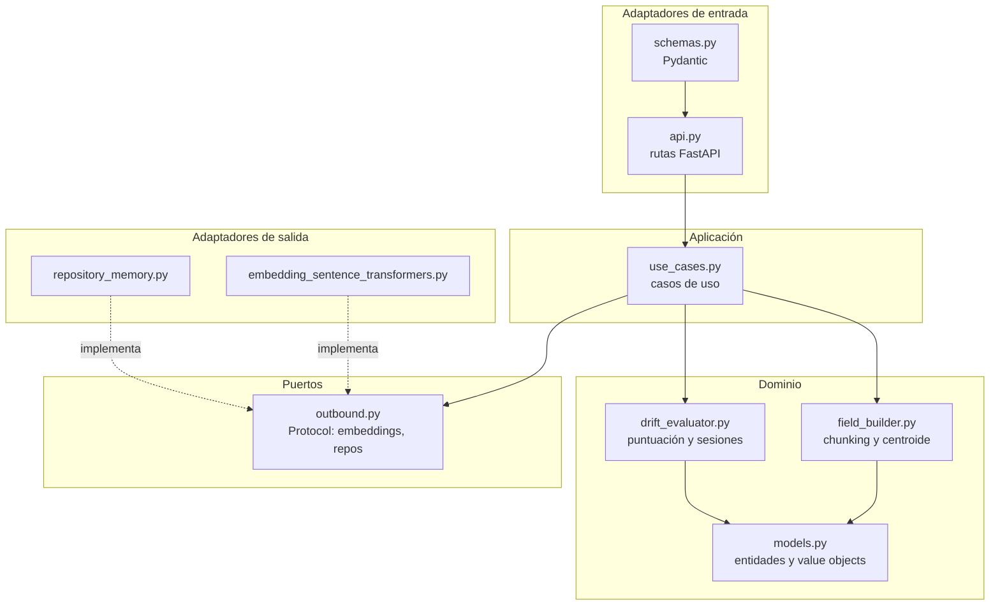
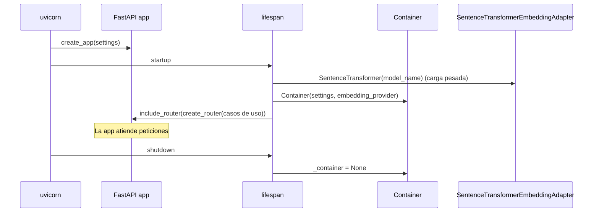

# Arquitectura

LLMKeeper sigue una **arquitectura hexagonal** (puertos y adaptadores). La lógica de negocio no conoce FastAPI, sentence-transformers ni el almacenamiento: solo habla con interfaces (puertos) que la infraestructura implementa.

## Capas



| Capa | Ruta | Responsabilidad | Depende de |
|------|------|-----------------|------------|
| **Dominio** | `src/llmkeeper/domain/` | Modelos, chunking, centroide, puntuación, transiciones de estado | Solo `numpy` y la biblioteca estándar |
| **Puertos** | `src/llmkeeper/ports/outbound.py` | Contratos (`Protocol`) para embeddings y repositorios | Dominio |
| **Aplicación** | `src/llmkeeper/application/use_cases.py` | Orquesta cada operación: busca, calcula, guarda | Dominio y puertos |
| **Adaptadores de entrada** | `src/llmkeeper/adapters/inbound/` | Traduce HTTP a casos de uso y viceversa | Aplicación, FastAPI, Pydantic |
| **Adaptadores de salida** | `src/llmkeeper/adapters/outbound/` | Implementa los puertos con tecnologías concretas | Dominio, puertos, sentence-transformers |
| **Infraestructura** | `src/llmkeeper/infrastructure/` | Configuración, cableado de dependencias, fábrica de la app | Todo lo anterior |

### Regla de dependencias

Las flechas de dependencia apuntan **hacia el dominio**:

- El dominio no importa nada de `adapters`, `infrastructure` ni de FastAPI.
- La aplicación depende de **puertos**, no de implementaciones. Por eso los tests pueden usar `ScriptedEmbeddingProvider` en lugar del modelo real.
- Solo `infrastructure/` conoce qué implementación concreta se usa.

## Puertos

Definidos en `ports/outbound.py` como `typing.Protocol` (tipado estructural: no hace falta heredar).

```python
class EmbeddingProviderPort(Protocol):
    def embed(self, text: str) -> Embedding: ...
    def embed_batch(self, texts: list[str]) -> list[Embedding]: ...

class FieldRepositoryPort(Protocol):
    def save(self, field: TopicField) -> None: ...
    def get(self, field_id: str) -> TopicField | None: ...
    def update_strictness(self, field_id: str, new_threshold: float, preset_name: str | None) -> None: ...

class SessionRepositoryPort(Protocol):
    def save(self, session: Session) -> None: ...
    def get(self, session_id: str) -> Session | None: ...
```

| Puerto | Implementación actual | Implementación prevista |
|--------|-----------------------|-------------------------|
| `EmbeddingProviderPort` | `SentenceTransformerEmbeddingAdapter` | Otros modelos locales o APIs de embeddings |
| `FieldRepositoryPort` | `InMemoryFieldRepository` | SQLite (`repository_sqlite.py`, pendiente) |
| `SessionRepositoryPort` | `InMemorySessionRepository` | SQLite (pendiente) |

## Modelo de dominio

Principales tipos en `domain/models.py`:

| Tipo | Rol |
|------|-----|
| `Embedding` | Vector `float32` con su dimensión y la operación de similitud coseno |
| `Anchor` | Un fragmento de tema (`text`) con su `embedding` |
| `StrictnessLevel` | Enumeración de presets, con su umbral asociado |
| `Strictness` | Umbral efectivo y preset de origen (si lo hay) |
| `TopicField` | Campo temático: anclas, centroide, dispersión, estrictud, `alpha`, `top_k` |
| `ValidationResult` | Resultado de puntuar un mensaje: `is_valid`, `score`, `threshold`, `nearest_anchor_text` |
| `Session` | Conversación: historial, contador de fuera de tema, estado, paciencia y ventana |
| `MessageScore` | Entrada del historial de una sesión |
| `SessionStatus` | `on_topic`, `warning`, `off_topic` |

Los campos y las sesiones son **mutables** (`@dataclass`); los `Embedding`, `Anchor` y `ValidationResult` son **inmutables** (`frozen=True`).

## Componentes de servicio (dominio)

- **`field_builder.py`**: `split_into_chunks`, `build_centroid`, `compute_dispersion`, `build_topic_field`. Convierte un texto y sus embeddings en un `TopicField`. Detalle en [puntuacion.md](puntuacion.md#construcción-del-campo-temático).
- **`drift_evaluator.py`**: `score_against_field` (puntúa un mensaje) y `append_message_to_session` (actualiza contador y estado). Son funciones puras sobre el modelo. Detalle en [puntuacion.md](puntuacion.md#fórmula-de-puntuación) y [flujos.md](flujos.md#flujo-de-sesión-y-estados).

## Casos de uso

Cada caso de uso es una clase `@dataclass` que recibe sus puertos por constructor y expone `execute(...)`.

| Caso de uso | Puertos que usa | Qué hace |
|-------------|-----------------|----------|
| `CreateField` | embeddings, fields | Divide el prompt, embebe anclas y temas extra, construye y guarda el campo |
| `ValidateMessage` | embeddings, fields | Embebe el texto y lo puntúa contra el campo. No guarda nada |
| `AdjustStrictness` | fields | Cambia el umbral de un campo |
| `CreateSession` | fields, sessions | Crea una sesión asociada a un campo existente |
| `AppendMessageToSession` | embeddings, fields, sessions | Puntúa un mensaje y actualiza la sesión |
| `GetSession` | sessions | Devuelve una sesión |

Los errores de dominio son `FieldNotFoundError` y `SessionNotFoundError`. La capa HTTP los traduce a `404`.

## Cableado: contenedor y ciclo de vida

### Contenedor (`infrastructure/container.py`)

`Container` crea los repositorios en memoria y construye cada caso de uso inyectándole sus dependencias:

```python
class Container:
    def __init__(self, settings, embedding_provider):
        self.field_repository = InMemoryFieldRepository()
        self.session_repository = InMemorySessionRepository()
        # create_field_uc(), validate_message_uc(), ... devuelven casos de uso
```

### Fábrica de la aplicación (`infrastructure/app.py`)

`create_app(settings)` devuelve una `FastAPI`. El modelo de embeddings **no se carga al crear la app**, sino en el `lifespan` (arranque del servidor):



Consecuencias prácticas:

- Los tests usan `with TestClient(app) as client:` para ejecutar el `lifespan`. Sin el bloque `with`, las rutas no están registradas.
- El contenedor es una variable global del módulo. Es suficiente para un proceso, pero dificulta tener varias apps en el mismo proceso.

## Adaptadores de entrada (HTTP)

- **`adapters/inbound/api.py`**: `create_router(...)` recibe los casos de uso y define las rutas bajo `/api/v1`. Cada ruta convierte el cuerpo Pydantic en una llamada al caso de uso y el resultado en un esquema de respuesta.
- **`adapters/inbound/schemas.py`**: modelos Pydantic de petición y respuesta. Validan rangos (`strictness_value` en `[0, 1]`) y tipos de los presets con la enumeración `StrictnessLevel`.

La API no contiene lógica de negocio: solo traducción y códigos HTTP.

## Adaptadores de salida

- **`embedding_sentence_transformers.py`**: `SentenceTransformerEmbeddingAdapter` carga el modelo en CPU y expone `embed` y `embed_batch`. Los vectores se devuelven sin normalizar; la similitud coseno se calcula en el dominio.
- **`repository_memory.py`**: diccionarios en memoria. Son válidos para desarrollo y tests; no persisten.

## Decisiones de diseño

| Decisión | Motivo |
|----------|--------|
| Hexagonal en lugar de un servicio monolítico | Permite probar el dominio sin modelo ni HTTP, y cambiar el almacenamiento sin tocar la lógica. |
| Embeddings locales | Privacidad: el texto de la conversación no sale del equipo. Coste cero por mensaje. |
| Modelo multilingüe | Los *system prompts* y los mensajes pueden estar en español. |
| Funciones puras para puntuación y estado | Son deterministas y se testean con vectores construidos a mano. |
| Puntuación híbrida (anclas + centroide) | Una sola ancla puede ser muy específica; el centroide suaviza. Ver [puntuacion.md](puntuacion.md). |
