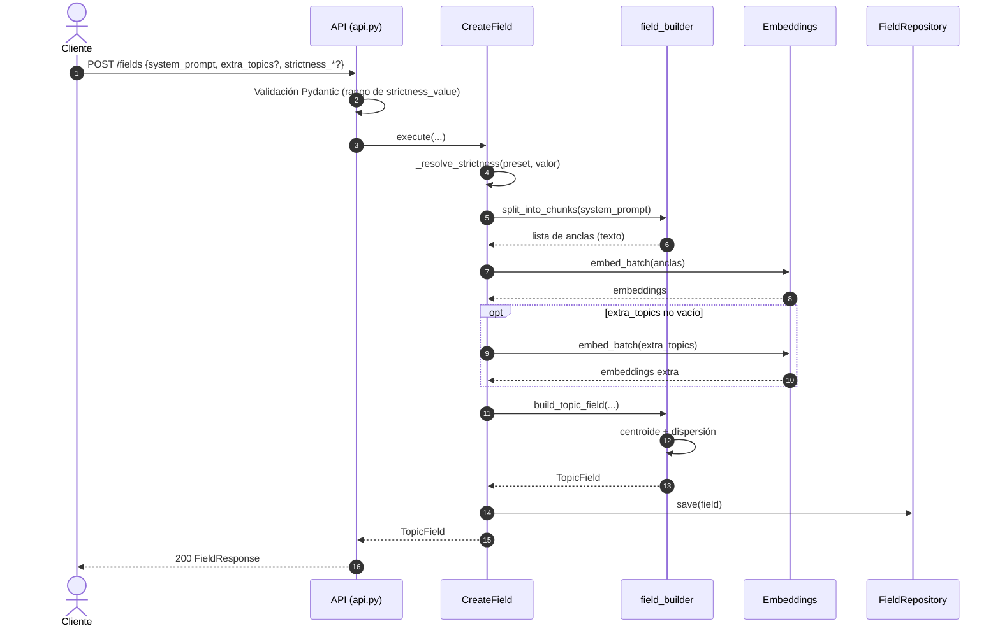
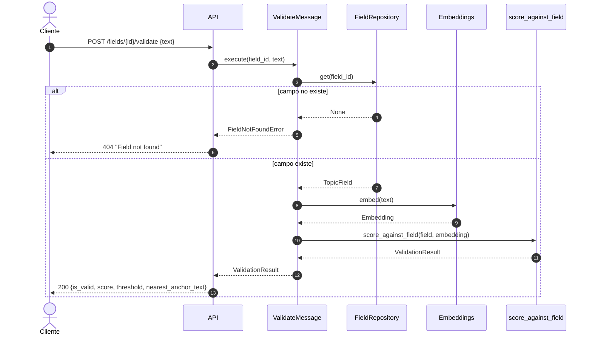
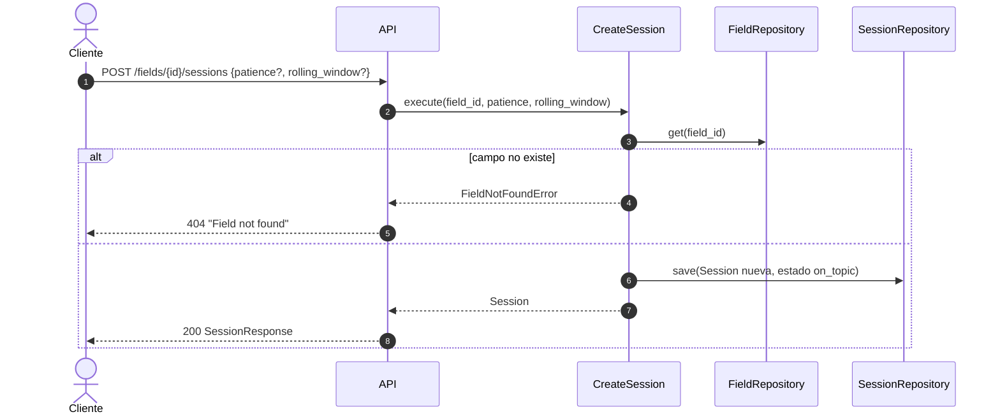
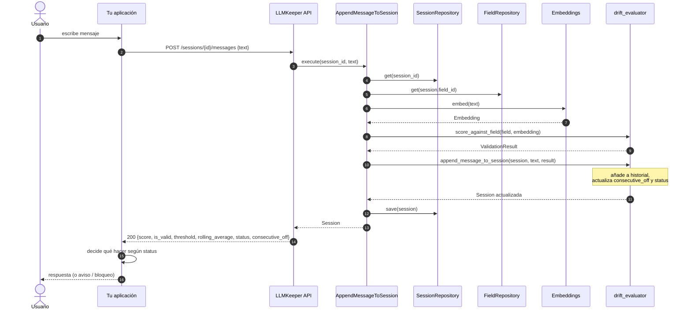
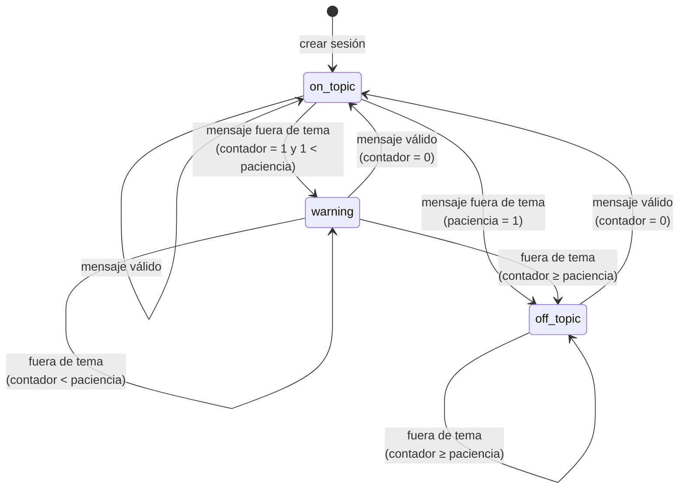
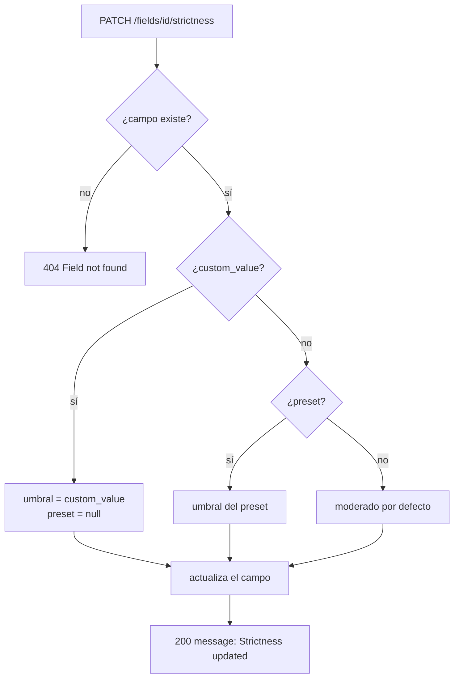

# Flujos

Recorrido paso a paso de cada operación: qué llama al qué, qué se guarda y qué puede fallar.

- [Flujo 1: crear un campo temático](#flujo-1-crear-un-campo-temático)
- [Flujo 2: validar un mensaje suelto](#flujo-2-validar-un-mensaje-suelto)
- [Flujo 3: crear una sesión](#flujo-3-crear-una-sesión)
- [Flujo 4: enviar un mensaje a una sesión](#flujo-4-enviar-un-mensaje-a-una-sesión)
- [Flujo de sesión y estados](#flujo-de-sesión-y-estados)
- [Flujo 5: cambiar la estrictud](#flujo-5-cambiar-la-estrictud)
- [Flujo 6: consultar campo o sesión](#flujo-6-consultar-campo-o-sesión)
- [Errores y códigos de respuesta](#errores-y-códigos-de-respuesta)
- [Ejemplo completo de una conversación](#ejemplo-completo-de-una-conversación)

---

## Flujo 1: crear un campo temático

**Endpoint:** `POST /api/v1/fields` · **Caso de uso:** `CreateField`



### Pasos

1. **Validación.** Pydantic comprueba que `system_prompt` es texto y que `strictness_value`, si existe, está en `[0, 1]`. Un `strictness_preset` desconocido también se rechaza.
2. **Resolución de estrictud.** Si hay `strictness_value`, gana. Si no, se usa `strictness_preset`. Si no hay ninguno, `moderado`.
3. **Chunking.** Se obtienen las anclas del *system prompt* ([detalle](puntuacion.md#1-chunking-split_into_chunks)).
4. **Embeddings.** Todas las anclas (y los `extra_topics`) se embeben en lote.
5. **Construcción.** Se crean las anclas, el centroide y la dispersión. `alpha = 0.7` y `top_k = 3` por defecto.
6. **Persistencia.** El campo se guarda en el repositorio con un UUID nuevo.
7. **Respuesta.** Se devuelve el `field_id` y los metadatos. El `system_prompt` no se modifica.

### Respuesta

| Campo | Significado |
|-------|-------------|
| `field_id` | Identificador a usar en el resto de llamadas |
| `num_anchors` | Número total de anclas (prompt + `extra_topics`) |
| `dispersion` | Distancia coseno media al centroide |
| `threshold` | Umbral efectivo |
| `preset` | Preset de origen, o `null` si el umbral es personalizado |
| `alpha`, `top_k` | Parámetros de puntuación del campo |

---

## Flujo 2: validar un mensaje suelto

**Endpoint:** `POST /api/v1/fields/{field_id}/validate` · **Caso de uso:** `ValidateMessage`

Operación **sin estado**: no crea ni modifica sesiones. Útil para filtrar un mensaje antes de enviarlo al LLM, o para probar un campo.



`nearest_anchor_text` es la ancla con mayor similitud coseno, útil para entender por qué el mensaje cae cerca de un subtema.

---

## Flujo 3: crear una sesión

**Endpoint:** `POST /api/v1/fields/{field_id}/sessions` · **Caso de uso:** `CreateSession`



| Parámetro | Por defecto | Significado |
|-----------|-------------|-------------|
| `patience` | `3` | Mensajes consecutivos fuera de tema necesarios para pasar a `off_topic` |
| `rolling_window` | `5` | Número de mensajes que entran en la media móvil |

La sesión nace con `status = on_topic`, `consecutive_off = 0` y sin historial. Un mismo campo puede tener muchas sesiones; cada una tiene su propio estado.

---

## Flujo 4: enviar un mensaje a una sesión

**Endpoint:** `POST /api/v1/sessions/{session_id}/messages` · **Caso de uso:** `AppendMessageToSession`

Es el flujo principal de una conversación en curso.



### Qué se actualiza

| Campo de sesión | Regla |
|-----------------|-------|
| `history` | Se añade un `MessageScore` con texto, `score`, `is_valid`, `threshold` y marca temporal |
| `consecutive_off` | `0` si el mensaje es válido; `+1` si no lo es |
| `status` | Ver [estados](#flujo-de-sesión-y-estados) |

### Qué devuelve

- `score`, `is_valid`, `threshold`: resultado de **este** mensaje.
- `rolling_average`: media de los últimos `rolling_window` scores.
- `status`, `consecutive_off`: estado **después** de este mensaje.

> **Importante:** el mensaje se registra en el historial aunque sea inválido. La sesión guarda todo lo que el usuario envió; decidir si el mensaje llega o no al LLM es responsabilidad de tu aplicación.

---

## Flujo de sesión y estados

El estado depende **solo** del contador de mensajes consecutivos fuera de tema y de la paciencia:



### Regla exacta

Sea $c$ el contador tras el mensaje y $p$ la paciencia:

| Condición | Estado |
|-----------|--------|
| $c = 0$ | `on_topic` |
| $0 < c < p$ | `warning` |
| $c \ge p$ | `off_topic` |

Con $p = 3$:

| Mensaje | Válido | $c$ | Estado |
|---------|--------|-----|--------|
| 1 | sí | 0 | `on_topic` |
| 2 | no | 1 | `warning` |
| 3 | no | 2 | `warning` |
| 4 | no | 3 | `off_topic` |
| 5 | no | 4 | `off_topic` |
| 6 | sí | 0 | `on_topic` |

Un único mensaje válido en medio **reinicia el contador**. Por eso la paciencia tolera desvíos puntuales pero no desvíos sostenidos.

### Media móvil

`rolling_average` es independiente del estado. Sirve para ver tendencias: una media que baja aunque el estado siga en `on_topic` avisa de una deriva lenta. Con historial vacío vale `1.0`.

---

## Flujo 5: cambiar la estrictud

**Endpoint:** `PATCH /api/v1/fields/{field_id}/strictness` · **Caso de uso:** `AdjustStrictness`



- Solo cambia el campo; las sesiones existentes siguen apuntando a él y usarán el nuevo umbral desde el siguiente mensaje.
- El historial de cada sesión conserva el umbral con el que se evaluó cada mensaje.

---

## Flujo 6: consultar campo o sesión

| Endpoint | Caso de uso | Devuelve | Sin efectos |
|----------|-------------|----------|-------------|
| `GET /fields/{field_id}` | — (consulta directa al repositorio) | Metadatos del campo | Sí |
| `GET /sessions/{session_id}` | `GetSession` | Estado, paciencia, ventana, media y número de mensajes | Sí |

`GET /sessions/{id}` **no** devuelve el historial de mensajes, solo `num_messages`.

---

## Errores y códigos de respuesta

| Código | Cuándo | Cuerpo |
|--------|--------|--------|
| `200` | Operación correcta | Según el endpoint |
| `404` | `field_id` o `session_id` inexistente | `{"detail": "Field not found"}` o `{"detail": "Session not found"}` |
| `422` | Cuerpo mal formado, tipo incorrecto, `strictness_value` fuera de `[0, 1]`, preset desconocido | Detalle de validación de Pydantic |

Puntos a tener en cuenta:

- No hay endpoints de borrado, así que en la práctica un campo existente nunca desaparece mientras el proceso esté activo.
- `PATCH` sobre un campo inexistente devuelve `404`. Internamente, el repositorio ignoraría silenciosamente un `update_strictness` sobre un id desconocido, pero el caso de uso comprueba antes la existencia.
- No hay códigos `500` controlados: un fallo del modelo de embeddings se propaga como error de servidor.

---

## Ejemplo completo de una conversación

Campo creado con `moderado` (umbral `0.22`) y sesión con `patience = 2`:

```text
1. POST /fields/F/sessions            → status: on_topic, consecutive_off: 0
2. "¿Cómo hago un sofrito?"           → valid, score ≈ 0.65 → on_topic
3. "¿Cuál es la capital de Francia?"  → NO valid               → warning   (c=1 < 2)
4. "¿Y el fútbol de ayer?"             → NO valid               → off_topic (c=2 ≥ 2)
5. "¿Qué vino va con el pescado?"      → valid                  → on_topic  (c=0)
```

Tu aplicación podría:

- En `on_topic`: enviar el mensaje al LLM.
- En `warning`: enviarlo, pero añadir una nota de contexto al *system prompt* o mostrar un aviso.
- En `off_topic`: no enviarlo y pedir al usuario que reformule.

LLMKeeper no impone ninguna de estas acciones.
